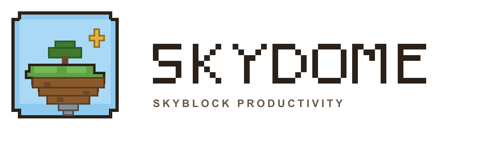

# SkyDome 🏝️

SkyDome is a Skyblock-inspired productivity app. Turn tasks and daily habits into island progress, minion rewards, skill XP, and cosmetic unlocks.



## Getting started

Requires Node.js 20.9 or later.

```bash
npm install
npm run dev
```

Open [http://localhost:3000](http://localhost:3000).

To create and run a production build locally:

```bash
npm run build
npm start
```

The app does not require environment variables or a backend. Progress is stored in the browser and can be backed up through the import/export controls in Settings.

## What you can do

- **Grow your island:** Earn XP from productivity, level up, and expand a rotatable voxel island with trees, houses, crops, water, decorations, and pets.
- **Plan work:** Create quests with priorities, due dates, tags, and checklists. Quick Add understands natural-language dates and priority tags.
- **Build habits:** Track recurring minion plots, harvest rewards, upgrade minions, and review habit history.
- **Focus:** Run Pomodoro sessions in the Mining Shaft, collect ores, and link a session to a quest. A running session remains visible while navigating the app.
- **Shop and unlock:** Use coins and ores in the Bazaar for island items, farm plots, and themed cosmetics. Item categories and level requirements help track unlocks.
- **Read and write guides:** The Island Library supports Markdown headings, emphasis, lists, quotes, and inline code, with separate reading and editing views.
- **Review progress:** Use the Almanac, skill pages, streaks, and XP summaries to see what you have completed.
- **Make it yours:** Choose Day, Sunset, Cloudy, Night, or the level-80 Galaxy theme. Adjust sound, music volume, reduced motion, and timer lengths in Settings.
- **Navigate on any screen:** Desktop uses a side navigation bar; small screens use a fixed header and bottom tab bar.

## Stack

- Next.js 16 with the App Router
- React 19 and TypeScript
- Tailwind CSS 4, compiled through the `@tailwindcss/postcss` plugin in `postcss.config.mjs`
- Three.js for the voxel island and mining visuals
- Zustand for app state and browser persistence
- Recharts for analytics

## Project layout

```text
app/                  App Router entry points, global styles, and layout
components/            App shell, navigation, shared UI, and feature views
components/island/     Island scene and voxel rendering
components/views/      Dashboard, quests, minions, mining, library, and settings
lib/                   Date parsing, sound, textures, and shared types
store/useSkyDoStore.ts Persistent application state and progression logic
public/                 Logo, bundled background music, and other static assets
postcss.config.mjs      Tailwind CSS 4 PostCSS setup for production and development
```

## Deploying to Vercel

Import the repository into Vercel and use the detected Next.js settings. The build command is `npm run build`; no environment variables are required. Keep `postcss.config.mjs`, `package.json`, and `package-lock.json` in the deployment so Tailwind styles are generated in production.

## Assets

SkyDome is an original productivity app with custom voxel-inspired graphics. It does not include proprietary Minecraft or Hypixel game assets.
